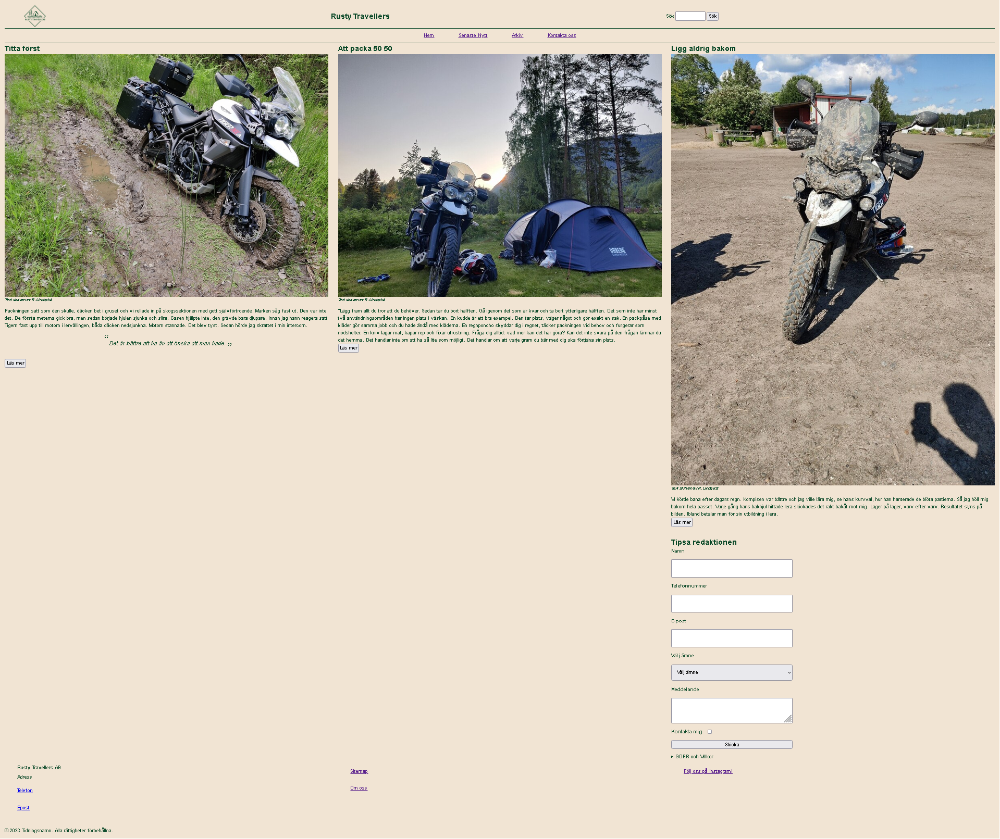
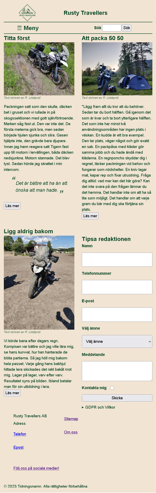
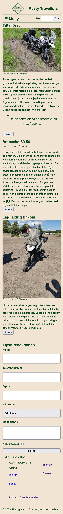

# Inlämningsuppgift 2

## Tidningssida

En responsiv tidningssida byggd mobile first. Skoluppgift i kursen JavaScript, HTML och CSS på Medieinstitutet, hösten 2026.

Se sidan: https://lindqvistrl.github.io/tidning/

## Vad sidan innehåller

- Sidhuvud med logga, sök och hamburgermeny på mobil
- Kontaktformulär där varje fält har en kopplad etikett
- Sidfot som går från två till tre kolumner på bredare skärmar

## Byggd med

- HTML med semantiska element
- Sass, uppdelat i filer för mobil, surfplatta och desktop
- CSS Grid och Flexbox
- JavaScript för menyn och bildvisningen

## Skärmbilder

### Desktop

### Surfplatta

### Mobil

## Tidsplanering

| Uppgift | Planerad tid | Faktisk tid |
| --- | --- | --- |
| Header med logga och titel | 3 SP | 4 h |
| Meny, sök, navigering | 3 SP | 3 h |
| Artikel 1 med citat och bild | 3 SP | 2 h |
| Artikel 2 | 3 SP | 1,5 h |
| Artikel 3 med bild | 3 SP | 2 h |
| Kontaktformulär | 2 SP | 1 h |
| Footer | 1 SP | 2 h |
| Meny till formulär | 0,5 SP | 1 h |
| Tillgänglighetsanpassning | 3 SP | 2 h |
